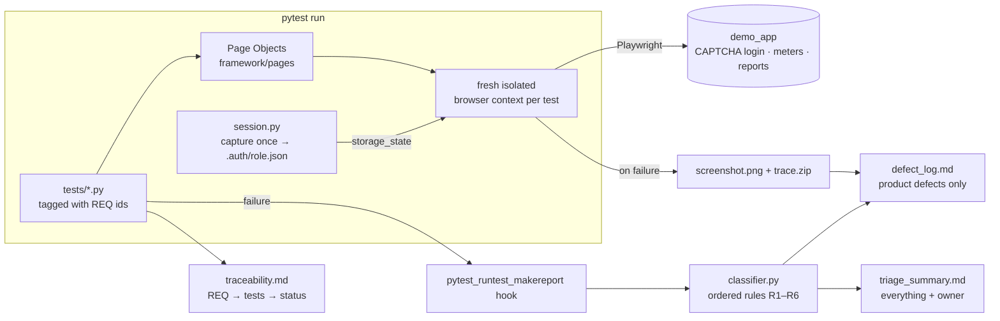

# Agentic QA Framework (public demo)

[](https://github.com/hermiones/agentic-qa-framework/actions/workflows/ci.yml)

**This is a sanitised, public re-implementation of the approach I use at work. The product code is under NDA.**
It runs against a small local demo app (`demo_app/`, a fake smart-meter dashboard), so you can clone it and see every piece working.

What it demonstrates:

| Problem at work | What the framework does |
|---|---|
| Login is behind a **server-side CAPTCHA** that automation can't (and shouldn't) solve | **Session capture & replay**: capture one authenticated session, replay it into isolated contexts, and **skip** (not fail) when it has expired |
| Every red test gets triaged by hand, and the defect register fills up with noise | **Automatic failure classification** into `product_defect` / `ui_change` / `environment` / `test_data` / `test_issue`, with a screenshot and trace attached. Only real product defects reach the defect log |
| "What does this suite actually cover?" | **Requirement traceability**: tests are tagged `@pytest.mark.req("REQ-xxx")`, and every run writes a coverage table that includes uncovered requirements |
| Brittle scripts | **Page Object Model**, `data-testid` locators and Playwright auto-waiting, with **no sleeps** anywhere |
| One browser only | Same suite on **Chromium, Firefox and WebKit** (CI matrix) |

## Architecture



```
framework/
  pages/            Page Object Model (login, dashboard, meters, meter detail, reports)
  session.py        session capture, validation and replay
  classifier.py     failure classification rules
  reporting.py      defect log, triage summary, traceability, JSON
  assertions.py     expect_business(): marks business-value checks
  data.py           test oracle: expected values from the seed data
conftest.py         fixtures (isolated contexts, tracing, artifacts) + the classification hook
tests/              12 tests + 3 intentional demo failures
demo_app/           system under test (Python stdlib only)
requirements.yaml   the "requirement tracker"
scripts/check_classifier.py   CI self-test for the classifier
```

## How session replay works

1. **Capture once.** `framework/session.py` gets an authenticated session for a seeded role (`viewer` or `admin`) and saves Playwright storage state to `.auth/<role>.json`. In the demo, a test-only endpoint (`/__test__/session`) stands in for "a human signs in once, solving the CAPTCHA".
2. **Validate before use.** `GET /api/whoami` checks that the stored session is still alive. A valid file is reused across runs.
3. **Replay in isolation.** Each test gets a **brand-new browser context** loaded with that state, so there are no logins in tests, no shared state between tests, and no CAPTCHA.
4. **Expired? Skip, don't fail.** If the session can't be validated, the test is **skipped with a clear message**, so an expired login never shows up as a false product failure.

Try the expired-session behaviour:

```bash
DEMO_PORT=8766 DEMO_SESSION_TTL=0 python demo_app/server.py &
pytest --base-url http://127.0.0.1:8766 --recapture-session -k replayed_session -rs
# SKIPPED ... session for 'viewer' is not valid: captured 'viewer' session was rejected immediately;
# it has probably expired ... Skipping instead of reporting a false auth failure.
```

## Failure classification rules

Implemented in [`framework/classifier.py`](framework/classifier.py). Rules are checked in order, and the first match wins. The exception chain is inspected, so a wrapped error is classified by its root cause.

| Rule | Category | When |
|---|---|---|
| R1 | `test_data` | `TestDataError`, or a missing or invalid fixture file during setup |
| R2 | `environment` | Connection refused, DNS failure, HTTP 5xx, or `EnvironmentUnavailable` |
| R3 | `product_defect` | `BusinessRuleViolation`: a business value (count, total, status) is wrong (`expect_business()`) |
| R4 | `ui_change` | A locator timed out waiting for an element, or the element was not found: the UI changed under the test |
| R5 | `product_defect` | Any other assertion on what the product shows (Playwright `expect` or `assert`) |
| R6 | `test_issue` | Anything else (`TypeError`, `NameError`, bad test code) |

On failure, the fixture keeps a **full-page screenshot and a Playwright trace** (`playwright show-trace reports/artifacts/<test>/trace.zip`).

Outputs in `reports/`:
- `defect_log.md`: **only `product_defect`**, with test, browser, requirement, rule and evidence
- `triage_summary.md`: every failure, its category and the owning team
- `traceability.md`: requirement → tests → status, including **uncovered** requirements
- `classification.json`: the same data, machine-readable

## Run it locally

```bash
python -m venv .venv && source .venv/bin/activate
pip install -r requirements.txt
python -m playwright install chromium        # or firefox / webkit

python demo_app/server.py &                  # http://127.0.0.1:8765
pytest                                        # chromium by default
pytest --browser firefox --browser webkit     # cross-browser
```

Expected:

```
12 passed, 3 skipped
SKIPPED [3] intentional demo failure; run with DEMO_FAILURES=1 to see the classifier
```

### See the classifier in action

The demo app ships with **one deliberate bug**: the dashboard counts meters "under maintenance" as online. Three tests fail on purpose, each for a different reason:

```bash
DEMO_FAILURES=1 pytest tests/test_demo_failures.py
```

```
============================ failure classification ============================
product_defect  R3  test_demo_product_defect_online_kpi[chromium]        ->  [business] online meters KPI: expected 5, got 6
ui_change       R4  test_demo_ui_change_export_button_renamed[chromium]  ->  Locator.click: Timeout 2000ms exceeded.
environment     R2  test_demo_environment_dependency_down                ->  APIRequestContext.get: connect ECONNREFUSED 127.0.0.1:9
```

`reports/defect_log.md` then contains **one** entry (the real bug). The locator change goes to QA and the dead dependency goes to DevOps:

```markdown
## DEF-001: [business] online meters KPI: expected 5, got 6
- Test: tests/test_demo_failures.py::test_demo_product_defect_online_kpi[chromium]
- Browser: chromium
- Requirement(s): REQ-015
- Screenshot: reports/artifacts/.../screenshot.png
- Trace: reports/artifacts/.../trace.zip
```

### Traceability output (excerpt)

| Requirement | Title | Status |
|---|---|---|
| REQ-001 | Login requires a valid server-side CAPTCHA | ✅ passing |
| REQ-013 | Meter total equals the sum of its readings | ✅ passing |
| REQ-015 | Dashboard online KPI counts only online meters | ❌ failing (with DEMO_FAILURES=1) |
| REQ-030 | Report downloads are written to the audit log | ⚠️ not covered |
| REQ-031 | Users can reset a forgotten password | ⚠️ not covered |

**Coverage: 13/15 requirements have at least one test.**

## CI

[`.github/workflows/ci.yml`](.github/workflows/ci.yml):
- **e2e matrix** on Chromium, Firefox and WebKit. It starts the demo app, runs the suite and uploads `reports/` as an artifact.
- **classifier self-test**: runs the intentional failures, then `scripts/check_classifier.py` asserts that each one landed in the expected bucket and that only the product defect reached the defect log. In other words, the triage logic is tested too.

## Configuration

| Env var | Default | Purpose |
|---|---|---|
| `DEMO_BASE_URL` / `--base-url` | `http://127.0.0.1:8765` | system under test |
| `DEMO_PORT` | `8765` | demo app port |
| `DEMO_SESSION_TTL` | `3600` | demo app session lifetime (seconds) |
| `DEMO_TEST_HOOKS` | `1` | set `0` to disable the test-only session endpoint |
| `DEMO_FAILURES` | unset | `1` runs the intentional demo failures |
| `DEMO_TIMEOUT_MS` | `5000` | default Playwright action timeout |

The demo credentials in `demo_app/fixtures/users.json` exist only for this local test app.

---

Built by [Sudipta Mohanty](https://sudipta.site), SDET.
